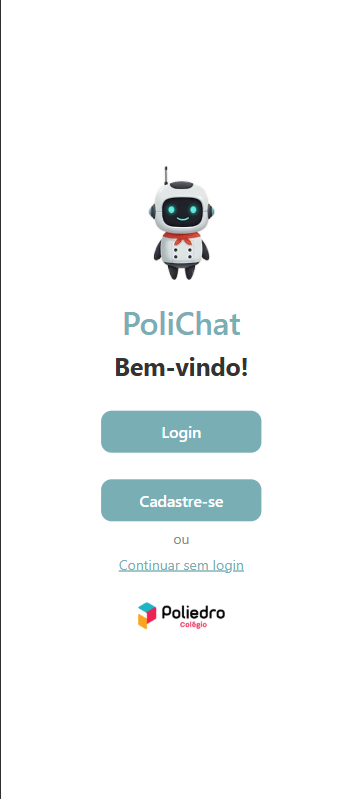
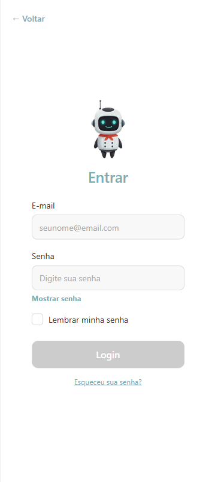
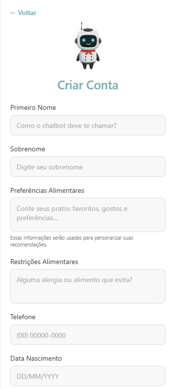

<h1 align="center">Projeto Integrador Interdisciplinar:<br>Desenvolvimento de Chatbot para os Restaurantes do Colégio Poliedro</h1>

<!-- Introdução -->
<p align="justify">Este projeto universitário foi desenvolvido como parte da disciplina <strong>Projeto Integrador Interdisciplinar - Ciência da Computação (CIC204)</strong> dos cursos de <strong>Ciência da Computação</strong> e <strong>Inteligência Artificial e Ciência de Dados</strong> do Instituto Mauá de Tecnologia.</p>
<p align="justify">O projeto visa desenvolver um sistema integrado de gestão de pedidos para o restaurante do <strong>Colégio Poliedro</strong>, com a implementação de um chatbot para otimizar a experiência dos clientes. O objetivo principal é facilitar o processo de pedidos no restaurante e oferecer uma forma eficiente, moderna e humanizada para os clientes interagirem com o sistema.</p>

<!-- Parceria -->

## 🤝 Parceria

<div align="center" style="display: flex; flex-direction: row; align-items: center; width: 100%; justify-content: center; gap: 16px; flex-wrap: wrap;">
    <!-- IMT -->
    <a href="https://www.maua.br" target="_blank">
        
    </a>
    <!-- Poliedro -->
    <a href="https://www.colegiopoliedro.com.br" target="_blank">
        
    </a>
</div>

<!-- Integrantes -->

## 🧑🏻‍💻 Integrantes do Projeto

|                                   Aluno                                    |     RA     |
| :------------------------------------------------------------------------: | :--------: |
|        [Alexandre Raminelli](https://github.com/alexandreraminelli)        | 24.01625-0 |
| [Henrique Yuri Cawamura Seppelfelt](https://github.com/HenriqueSeppelfelt) | 24.00545-2 |
|      [Mateus Martins Gonçalves Dóro ](https://github.com/mateusmats)       | 24.00553-3 |
|            [Pedro Correia ](https://github.com/PedroCorreia73)             | 24.00845-0 |

---

<!-- Instruções para configurar variáveis de ambiente -->

## ⚙️ Configurando variáveis de ambiente

1. **Navegue até a pasta `api/`:**

```bash
cd ./api
```

2. **Copie o arquivo `.env.example` para `.env`:**

```bash
cp .env.example .env
```

3. **Configure as variáveis de ambiente no `api/.env`:**

<!-- Variáveis de ambiente do banco de dados -->

3.1. **Conexão com o banco de dados:**

- `DATABASE_URL`: URL de conexão com o banco de dados PostgreSQL. O formato é `postgresql://<usuário>:<senha>@<host>:<porta>/<nome_do_banco>`.

- `SECRET_KEY`: Chave secreta para criptografia de dados sensíveis, como senhas.

<!-- Variáveis de ambiente do chatbot -->

3.2. **Conexão com o LLM:**

- `CHATBOT_API_KEY`: Chave de API para autenticação com o provedor do chatbot.
- `CHATBOT_URL`: URL base do provedor do chatbot.
- `MODEL_NAME`: Nome do modelo de linguagem utilizado pelo chatbot.

<!-- Instruções para usar o OpenRouter -->

### Recomendação: OpenRouter

Se estiver testando esse projeto, recomendados utilizar o OpenRouter como provedor de modelo de LLM. Para isso, crie uma conta gratuita em [OpenRouter](https://openrouter.ai/) e obtenha sua chave de API.

Também recomendados utilizar o modelo gratuito ["Meta: Llama 3.1 8B Instruct"](https://openrouter.ai/meta-llama/llama-3.1-8b-instruct:free).

Depois, configure as variáveis de ambiente conforme abaixo:

```env
CHATBOT_API_KEY=your_openrouter_api_key

CHATBOT_URL=https://api.openrouter.ai/v1

MODEL_NAME=meta-llama/llama-3.1-8b-instruct:free # ou outro modelo de sua escolha
```

---

<!-- Pinecone -->

## 🗃️ Criar banco de dados vetorial no Pinecone

1. **Insira no `api/.env` as informações para conexão com seu banco de dados vetorial (instruções acima)**

2. **Abra a pasta `api/` e execute o seguinte comando para criar o banco de dados vetorial:**

```bash
cd api &&
python -m embedding.build_vector_database
```

---

<!-- Instruções para iniciar o servidor FastAPI -->

## ⚡ Executando o servidor FastAPI

### Pré-requisitos

- Python 3.8 ou superior
- pip (gerenciador de pacotes do Python)

### Passos para execução

1. **Navegue até a pasta `api/`:**

```bash
cd ./api/
```

2. **Instale as dependências do projeto:**

```bash
pip install -r requirements.txt
```

3. **Configure as variáveis de ambiente** (instruções acima)

4. **Inicie o servidor:**

```bash
uvicorn main:app --reload
```

5. **Acesse o servidor:**

- **API:** http://localhost:8000
- **Documentação interativa (Swagger)**: http://localhost:8000/docs
- **Documentação alternativa**: http://localhost:8000/redoc

## 📡 Endpoints disponíveis

- `GET /` - Endpoint de teste
- `POST /cadastro` - Cadastro de usuários
- `POST /login` - Autenticação de usuários
- `POST /chatbot` - Interação com o chatbot
- `GET /cozinha/pedidos` - Obter pedidos (requer autenticação)

## 🧪 Testando a API

### Executar o Script de Testes

1. **Siga as instruções acima para iniciar o servidor FastAPI.**

2. **Abra uma nova aba do terminal e navegue até a pasta `api/`:**

```bash
cd ./api/
```

3. **Execute o script de testes:**

```bash
python test_api.py
```

Esse script irá:

1. ✅ Verificar se a API está rodando
2. 🧪 Testar todos os endpoints
3. 💬 Oferecer um modo de chat interativo

---

<!-- Instruções para executar front-end -->
<!-- --- -->

---

## 📸 Capturas de Tela

### Aplicativo Cliente

#### Tela de Boas-Vindas



#### Tela de Login



#### Tela de Cadastro



<!-- ### Aplicativo Admin -->
